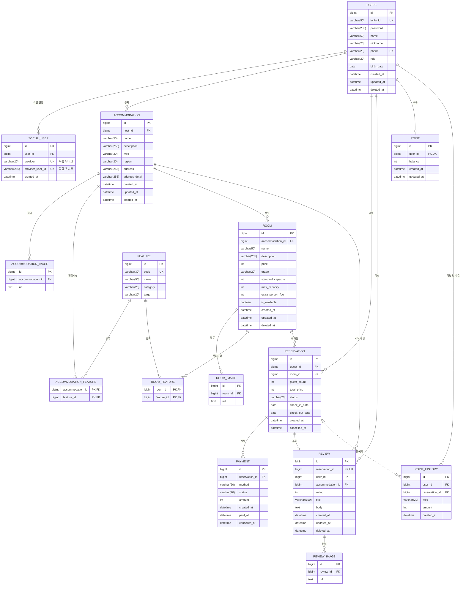

# ERD

- 기준: `db/01_schema.sql` (2026-11-24 확정)
- 테이블: 15개
- DB: MySQL 8 / InnoDB / utf8mb4

## 다이어그램

## 테이블 명세

제약 표기: `PK` 기본 키, `FK` 외래 키, `UK` 유니크, `NN` NOT NULL. 시각 컬럼의 실제 타입은 `DATETIME(6)`이다.

### 회원

#### users

| 컬럼 | 타입 | 제약 | 설명 |
|---|---|---|---|
| id | BIGINT | PK, AUTO_INCREMENT | |
| login_id | VARCHAR(50) | NN, UK | 소셜 유저는 임의 값 |
| password | VARCHAR(255) | NN | BCrypt 해시. 소셜 유저는 임의 값 |
| name | VARCHAR(50) | NN | |
| nickname | VARCHAR(20) | NN | |
| phone | VARCHAR(20) | NN, UK | |
| role | VARCHAR(20) | NN | enum `Role` |
| birth_date | DATE | NN | |
| created_at | DATETIME(6) | NN | |
| updated_at | DATETIME(6) | | |
| deleted_at | DATETIME(6) | | soft delete |

#### social_user

| 컬럼 | 타입 | 제약 | 설명 |
|---|---|---|---|
| id | BIGINT | PK, AUTO_INCREMENT | |
| user_id | BIGINT | NN, FK → users.id | |
| provider | VARCHAR(20) | NN | enum `Provider` |
| provider_user_id | VARCHAR(255) | NN | 제공자가 발급한 사용자 ID |
| created_at | DATETIME(6) | NN | |

- 복합 유니크: `(provider, provider_user_id)`

### 숙소

#### accommodation

| 컬럼 | 타입 | 제약 | 설명 |
|---|---|---|---|
| id | BIGINT | PK, AUTO_INCREMENT | |
| host_id | BIGINT | NN, FK → users.id | 숙소를 등록한 호스트 |
| name | VARCHAR(50) | NN | |
| description | VARCHAR(255) | | |
| type | VARCHAR(20) | NN | enum `AccommodationType` |
| region | VARCHAR(20) | NN | 필터용 시·도 |
| address | VARCHAR(255) | NN | |
| address_detail | VARCHAR(255) | NN | |
| created_at | DATETIME(6) | NN | |
| updated_at | DATETIME(6) | | |
| deleted_at | DATETIME(6) | | soft delete |

#### accommodation_image

| 컬럼 | 타입 | 제약 | 설명 |
|---|---|---|---|
| id | BIGINT | PK, AUTO_INCREMENT | |
| accommodation_id | BIGINT | NN, FK → accommodation.id | |
| url | TEXT | NN | |

#### room

| 컬럼 | 타입 | 제약 | 설명 |
|---|---|---|---|
| id | BIGINT | PK, AUTO_INCREMENT | |
| accommodation_id | BIGINT | NN, FK → accommodation.id | |
| name | VARCHAR(50) | NN | |
| description | VARCHAR(255) | | |
| price | INT | NN | |
| grade | VARCHAR(20) | NN | enum `RoomGrade` |
| standard_capacity | INT | NN | 기준 인원 |
| max_capacity | INT | NN | 최대 인원 |
| extra_person_fee | INT | NN, DEFAULT 0 | 기준 초과 인원 1명당 요금 |
| is_available | BOOLEAN | NN, DEFAULT TRUE | 판매 여부 |
| created_at | DATETIME(6) | NN | |
| updated_at | DATETIME(6) | | |
| deleted_at | DATETIME(6) | | soft delete |

#### room_image

| 컬럼 | 타입 | 제약 | 설명 |
|---|---|---|---|
| id | BIGINT | PK, AUTO_INCREMENT | |
| room_id | BIGINT | NN, FK → room.id | |
| url | TEXT | NN | |

### 편의시설

#### feature

| 컬럼 | 타입 | 제약 | 설명 |
|---|---|---|---|
| id | BIGINT | PK, AUTO_INCREMENT | |
| code | VARCHAR(30) | NN, UK | 항목 코드 (`PARKING`, `BATHTUB` 등) |
| name | VARCHAR(50) | NN | 표시 이름 |
| category | VARCHAR(20) | NN | enum `FeatureCategory` |
| target | VARCHAR(20) | NN | enum `FeatureTarget` |

#### accommodation_feature

| 컬럼 | 타입 | 제약 | 설명 |
|---|---|---|---|
| accommodation_id | BIGINT | PK, FK → accommodation.id | |
| feature_id | BIGINT | PK, FK → feature.id | `target`이 `ACCOMMODATION`인 항목만 |

- 인덱스: `(feature_id, accommodation_id)` (편의시설 필터 조회용)

#### room_feature

| 컬럼 | 타입 | 제약 | 설명 |
|---|---|---|---|
| room_id | BIGINT | PK, FK → room.id | |
| feature_id | BIGINT | PK, FK → feature.id | `target`이 `ROOM`인 항목만 |

### 예약·결제

#### reservation

| 컬럼 | 타입 | 제약 | 설명 |
|---|---|---|---|
| id | BIGINT | PK, AUTO_INCREMENT | |
| guest_id | BIGINT | NN, FK → users.id | 예약한 게스트 |
| room_id | BIGINT | NN, FK → room.id | |
| guest_count | INT | NN | |
| total_price | INT | NN | 예약 시점 금액 스냅샷 |
| status | VARCHAR(20) | NN | enum `ReservationStatus` |
| check_in_date | DATE | NN | |
| check_out_date | DATE | NN | |
| created_at | DATETIME(6) | NN | |
| cancelled_at | DATETIME(6) | | |

- 인덱스: `(room_id, check_in_date, check_out_date)` (예약 일정 조회, 중복 예약 검사용)

#### payment

| 컬럼 | 타입 | 제약 | 설명 |
|---|---|---|---|
| id | BIGINT | PK, AUTO_INCREMENT | |
| reservation_id | BIGINT | NN, FK → reservation.id | |
| method | VARCHAR(20) | NN | enum `PaymentMethod` |
| status | VARCHAR(20) | NN | enum `PaymentStatus` |
| amount | INT | NN | |
| created_at | DATETIME(6) | NN | |
| paid_at | DATETIME(6) | | |
| cancelled_at | DATETIME(6) | | |

### 포인트

#### point

| 컬럼 | 타입 | 제약 | 설명 |
|---|---|---|---|
| id | BIGINT | PK, AUTO_INCREMENT | |
| user_id | BIGINT | NN, UK, FK → users.id | 유저당 1행 |
| balance | INT | NN, DEFAULT 0 | 현재 잔액 |
| created_at | DATETIME(6) | NN | |
| updated_at | DATETIME(6) | | |

#### point_history

| 컬럼 | 타입 | 제약 | 설명 |
|---|---|---|---|
| id | BIGINT | PK, AUTO_INCREMENT | |
| user_id | BIGINT | NN, FK → users.id | |
| reservation_id | BIGINT | FK → reservation.id | 관련 예약 (없으면 NULL) |
| type | VARCHAR(20) | NN | enum `PointHistoryType` |
| amount | INT | NN | |
| created_at | DATETIME(6) | NN | |

### 리뷰

#### review

| 컬럼 | 타입 | 제약 | 설명 |
|---|---|---|---|
| id | BIGINT | PK, AUTO_INCREMENT | |
| reservation_id | BIGINT | NN, UK, FK → reservation.id | 예약당 리뷰 1개 |
| user_id | BIGINT | NN, FK → users.id | 작성자 |
| accommodation_id | BIGINT | NN, FK → accommodation.id | |
| rating | INT | NN, CHECK 1~5 | |
| title | VARCHAR(100) | | |
| body | TEXT | | |
| created_at | DATETIME(6) | NN | |
| updated_at | DATETIME(6) | | |
| deleted_at | DATETIME(6) | | soft delete |

#### review_image

| 컬럼 | 타입 | 제약 | 설명 |
|---|---|---|---|
| id | BIGINT | PK, AUTO_INCREMENT | |
| review_id | BIGINT | NN, FK → review.id | |
| url | TEXT | NN | |

## enum 값

enum은 모두 `VARCHAR`로 저장하고 자바에서 `@Enumerated(EnumType.STRING)`으로 매핑한다.

| 컬럼 | 값 | 상태 |
|---|---|---|
| users.role | GUEST, HOST, ADMIN | |
| social_user.provider | KAKAO, GOOGLE | |
| accommodation.type | HOTEL, MOTEL, PENSION, RESORT, POOL_VILLA, CAMPING | 확정 |
| room.grade | STANDARD, DELUXE, SUITE | 임시 |
| reservation.status | PENDING, CONFIRMED, CANCELLED | |
| payment.method | CARD, BANK_TRANSFER, KAKAO_PAY | 임시 |
| payment.status | READY, PAID, FAILED, CANCELLED | |
| point_history.type | EARN, USE, REFUND | |
| feature.category | AMENITY, FACILITY, SERVICE | |
| feature.target | ACCOMMODATION, ROOM | |

## feature 기준 데이터

`db/01_schema.sql` 끝에서 31행을 넣는다. 항목을 추가할 때는 그 INSERT 문에 행을 추가한다.

### 숙소 편의시설 (target = ACCOMMODATION)

| code | name | category |
|---|---|---|
| PARKING | 주차장 | FACILITY |
| POOL | 수영장 | FACILITY |
| FITNESS | 피트니스 | FACILITY |
| SAUNA | 사우나 | FACILITY |
| RESTAURANT | 레스토랑 | FACILITY |
| BBQ_AREA | 바비큐장 | FACILITY |
| LAUNDRY_ROOM | 세탁실 | FACILITY |
| SHOWER_ROOM | 공용 샤워실 | FACILITY |
| SHARED_KITCHEN | 공용 취사장 | FACILITY |
| WIFI | 와이파이 | SERVICE |
| BREAKFAST | 조식 | SERVICE |
| LUGGAGE_STORAGE | 짐보관 | SERVICE |
| PET_FRIENDLY | 반려견 동반 | SERVICE |
| SELF_CHECK_IN | 셀프 체크인 | SERVICE |
| FRONT_DESK_24H | 24시간 프런트 | SERVICE |

### 객실 편의시설 (target = ROOM)

| code | name | category |
|---|---|---|
| TOILETRIES | 욕실용품 | AMENITY |
| TOWELS | 수건 | AMENITY |
| HAIR_DRYER | 드라이기 | AMENITY |
| BATHROBE | 가운·슬리퍼 | AMENITY |
| BOTTLED_WATER | 생수 | AMENITY |
| BATHTUB | 욕조 | FACILITY |
| SPA | 스파·월풀 | FACILITY |
| KITCHEN | 주방·취사 | FACILITY |
| AIR_CONDITIONER | 에어컨 | FACILITY |
| OTT | OTT | FACILITY |
| PC | PC | FACILITY |
| STYLER | 스타일러 | FACILITY |
| TERRACE | 테라스 | FACILITY |
| PRIVATE_POOL | 개별 수영장 | FACILITY |
| PRIVATE_BBQ | 개별 바비큐 | FACILITY |
| ELECTRICITY | 전기 사용 | FACILITY |

## 설계 메모

- **soft delete**: `users`, `accommodation`, `room`, `review`는 `deleted_at`으로 삭제를 표시한다.
- **예약 금액**: 객실 가격이 바뀌어도 기존 예약에 영향이 없도록 `reservation.total_price`에 예약 시점 금액을 저장한다.
- **예약 취소**: 행을 지우지 않고 `status`를 `CANCELLED`로 바꾸고 `cancelled_at`을 기록한다.
- **리뷰**: `reservation_id`가 유니크라 예약당 1개만 쓸 수 있다. soft delete된 리뷰가 있는 예약에는 다시 쓸 수 없다.
- **포인트**: 잔액은 `point.balance`에서 읽고, `point_history`는 내역이다. 두 테이블은 같은 트랜잭션에서 함께 바꾼다.
- **편의시설 target 검증**: 객실에 숙소용 항목이 등록되는 것은 DB 제약으로 막지 못한다. 등록 API에서 `feature.target`을 검사한다.
- **Refresh 토큰**: 인메모리에 저장하므로 테이블이 없다. (추후 Redis로 확장 예정)